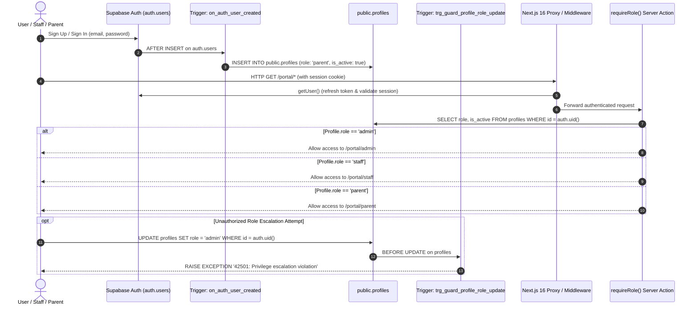
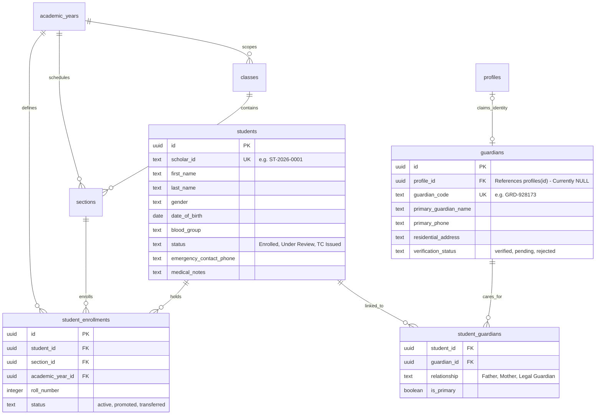
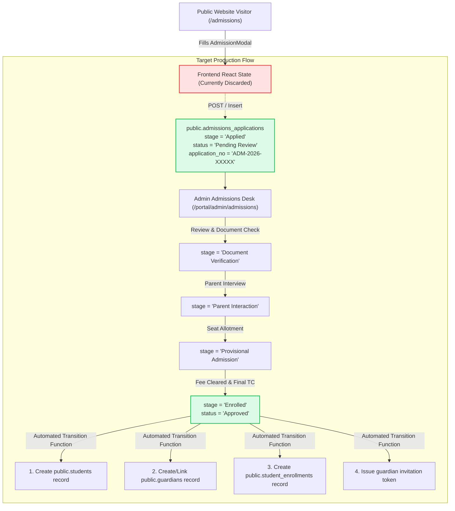
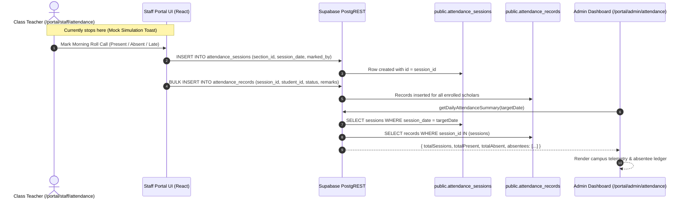
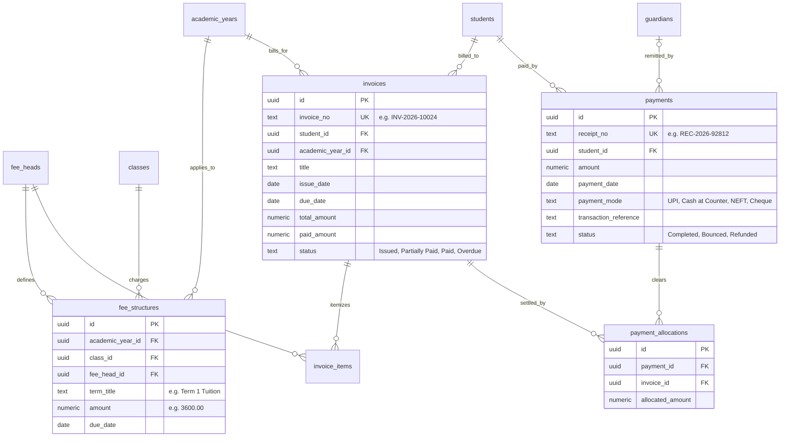
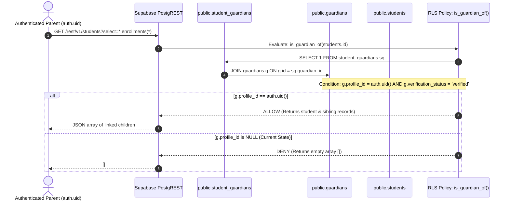
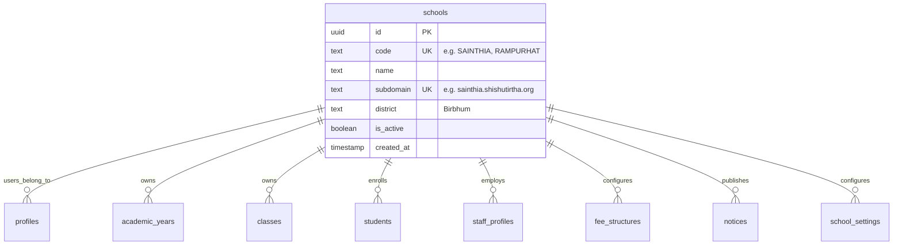

# Sainthia Shishutirtha — Data Flow & Relationship Architecture

**Document Date:** October 27, 2026  
**Auditor:** Antigravity (Advanced Agentic AI Assistant)  
**Database System:** Supabase PostgreSQL (`tybaaqktbdlnqsgodkek`, Region `ap-south-1`)  
**Scope:** Authoritative architectural blueprint of entity relationships, lifecycles, and data transitions.

---

## 1. Authentication & Profile Authorization Lifecycle



### Architectural Realities & Defect Analysis
1. **Default Role Trap**: `handle_new_auth_user()` hardcodes `role := 'parent'` for all new registrations. There is no automated provision for teachers or administrators to be assigned their role upon sign-up.
2. **SQL Editor Execution Context**: In the Supabase SQL Editor, `auth.uid()` evaluates to `NULL`. Because `guard_profile_role_update()` enforces `IF NOT public.is_admin()`, direct SQL updates executed by database administrators fail with privilege escalation errors unless `trg_guard_profile_role_update` is temporarily disabled inside a transactional block (`BEGIN ... COMMIT`).
3. **Staff Onboarding Gap**: When an administrator registers a teacher in `/portal/admin/faculty`, a record is inserted into `public.staff_profiles`, but `public.profiles.role` is left unchanged as `'parent'`. Consequently, the teacher remains trapped in `/portal/parent`.

---

## 2. Student Registration & Academic Placement Data Flow



### Transactional Mechanics of `registerStudent()`
In `src/lib/services/adminService.ts`, the student registration executes the following sequential steps:
1. **Insert `students`**: Generates a new student row with scholar ID (e.g. `ST-2026-0001`) and demographic details.
2. **Insert `guardians`**: Creates a guardian record with generated code `GRD-${Date.now().slice(-6)}`.
3. **Insert `student_guardians`**: Maps `student.id` to `guardian.id` with `relationship` and `is_primary = true`.
4. **Insert `student_enrollments`**: Places the student into a specific `section_id` and `academic_year_id` with an assigned `roll_number`.

### Critical Architecture Gaps
* **Guardian Orphanage**: `guardians.profile_id` is left `NULL`. The parent has no linked auth user, preventing parent portal login.
* **Sibling Linkage Failure**: Every student registered creates an independent guardian row, even if the phone number and guardian name match an existing parent. Siblings cannot be grouped under a single parent account.

---

## 3. Admission Enquiry to Enrolled Student Lifecycle



### Current Status vs. Intended Flow
* **Current State**: Step `B` terminates inside `src/components/modals/AdmissionModal.tsx` by setting a random string in React state. Step `D` reads from static mock array `ADMIN_ADMISSIONS_LIST`. Steps `E` through `L` do not exist in code.
* **Required Implementation**:
  1. Update `AdmissionModal.tsx` to insert directly into `public.admissions_applications` (permitted by public RLS).
  2. Implement `getAdmissionsApplications()` and `updateAdmissionStage()` in `adminService.ts`.
  3. Implement `promoteApplicationToEnrolledStudent(applicationId, sectionId, rollNumber)` to automate the conversion into SIS tables.

---

## 4. Classroom Attendance Lifecycle



### Key Integration Failure
* `/portal/admin/attendance` is fully written and tested to query `attendance_sessions` and `attendance_records`.
* `/portal/staff/attendance` is completely disconnected and never performs steps 2, 3, 4, and 5.
* **Fix Required**: Wire `StaffDailyAttendancePage` to load enrolled students from `student_enrollments` for the teacher's section and execute the batch insert into `attendance_sessions` and `attendance_records`.

---

## 5. Financial Ledger & Automated Invoicing Architecture



### Missing Engine: Invoice Generation
Currently, an administrator can define a `fee_structure` (e.g. Class II Tuition: ₹3,600) and can manually record a `payment`. However:
1. No background job or trigger generates `invoices` for students enrolled in that class.
2. When a payment is recorded, `payment_allocations` is never populated, so `invoices.paid_amount` remains `0` and `invoices.status` remains `Issued`.
3. The parent portal (`/portal/parent/fees`) cannot display dues because the student has 0 generated invoices in the database.

---

## 6. Parent-Child Sibling Access & RLS Flow



### The Sibling Connection Solution
To allow parents to see their children and switch between siblings:
1. When a student is enrolled, check if a guardian with the same `primary_phone` already exists. If so, reuse that `guardian_id`.
2. Generate an invitation record in `public.guardian_invitations` with a secure token.
3. When the parent registers or logs in with that phone or email, execute a claiming function:
   `UPDATE public.guardians SET profile_id = auth.uid() WHERE id = claimed_guardian_id;`
4. Once `guardians.profile_id = auth.uid()`, the existing `is_guardian_of()` RLS policy automatically unlocks access to all children linked via `student_guardians`!

---

## 7. Future Multi-School Tenant Isolation Data Model

The user request specifies: *identify the changes needed for school-level tenant isolation without redesigning or migrating anything yet.*

### Architectural Analysis
The existing schema was engineered as a single-institution system. To support multiple schools (e.g. Sainthia Shishutirtha, Rampurhat Shishutirtha, Suri Shishutirtha) within a single Supabase project while maintaining rigorous isolation:



### Required Adaptations (Blueprint Only)

1. **New Tenant Master Entity**:
   ```sql
   CREATE TABLE public.schools (
     id uuid PRIMARY KEY DEFAULT gen_random_uuid(),
     code text UNIQUE NOT NULL,
     name text NOT NULL,
     subdomain text UNIQUE NOT NULL,
     udise_code text UNIQUE,
     is_active boolean NOT NULL DEFAULT true,
     created_at timestamptz NOT NULL DEFAULT now()
   );
   ```

2. **Foreign Key Addition**:
   Add `school_id uuid NOT NULL REFERENCES public.schools(id) ON DELETE RESTRICT` to:
   - `academic_years`, `classes`, `sections`, `subjects`
   - `students`, `guardians`, `student_enrollments`
   - `staff_profiles`, `teacher_allocations`
   - `attendance_sessions`, `homework`, `assessments`, `report_cards`
   - `fee_heads`, `fee_structures`, `invoices`, `payments`
   - `admissions_applications`, `notices`, `school_settings`

3. **Compound Unique Constraints**:
   Replace single-column unique constraints with tenant-scoped constraints:
   - `students.scholar_id`: Unique per school `UNIQUE(school_id, scholar_id)`.
   - `classes.code`: Unique per school `UNIQUE(school_id, code)`.
   - `academic_years.code`: Unique per school `UNIQUE(school_id, code)`.
   - `admissions_applications.application_no`: Unique per school `UNIQUE(school_id, application_no)`.

4. **Multi-Tenant User Association**:
   Instead of `profiles` belonging to only one school, implement a membership table:
   ```sql
   CREATE TABLE public.school_memberships (
     id uuid PRIMARY KEY DEFAULT gen_random_uuid(),
     school_id uuid NOT NULL REFERENCES public.schools(id),
     profile_id uuid NOT NULL REFERENCES public.profiles(id),
     role app_role NOT NULL,
     is_active boolean NOT NULL DEFAULT true,
     UNIQUE(school_id, profile_id)
   );
   ```

5. **Tenant-Aware RLS Functions**:
   Update helper functions to evaluate the active tenant:
   ```sql
   CREATE OR REPLACE FUNCTION public.current_school_id()
   RETURNS uuid STABLE AS $$
     SELECT NULLIF(current_setting('request.headers', true)::jsonb->>'x-school-id', '')::uuid;
   $$ LANGUAGE sql;
   ```

6. **Next.js Hostname Routing**:
   In `src/proxy.ts`, resolve `x-school-id` from the request hostname (subdomain) or custom header and forward it in downstream Supabase client requests.
