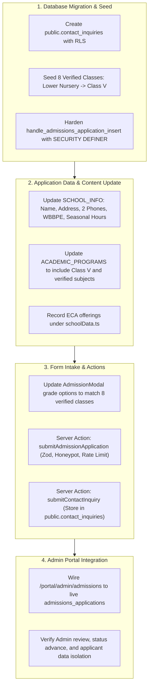

# Sainthia Shishutirtha — Milestone 5A Addendum: Verified School Data & Handbook Audit

**Date:** October 29, 2026  
**Status:** Audit & Planning Addendum (Zero Schema/Code Modifications)  
**Target Repository:** `D:\sainthiashishutirtha`  
**Primary Document:** [`docs/audit/milestone_5a_readiness_report.md`](file:///d:/sainthiashishutirtha/docs/audit/milestone_5a_readiness_report.md)  
**Context:** Incorporation of confirmed institutional facts, handbook photographs, class continuum, and curriculum details supplied by the school administration.

---

## 1. Confirmed School Institutional Facts

The following facts have been directly confirmed by school leadership and verified from handbook photography:

| Parameter | Confirmed Value | Audit & Engineering Notes |
| :--- | :--- | :--- |
| **Official School Name** | `Sainthia Shishu Tirtha` | The supplied official wording uses a space: **"Shishu Tirtha"**. The repository previously used the compound form "Shishutirtha". The official name should be adopted in public headings and SEO schema while keeping legacy code identifiers safe. |
| **Campus Address** | `Saradishpally, opposite Reliance Smart Point, Ward 1, Sainthia, Birbhum, West Bengal, 731234` | Replaces the placeholder *"Sainthia Town, District Birbhum"*. Highly specific for local Google Maps pin alignment and postal accuracy. |
| **Official Contact Numbers** | `9153336315`, `8926769992` | Replaces all dummy numbers (`+91 94740 12345`). Click-to-call links (`tel:9153336315`) must route directly to these two verified mobile lines. |
| **Year of Establishment** | `2013` | Confirmed; matches repository constant `estdYear: "2013"`. |
| **Classes Offered** | `Lower Nursery through Class V` | **Critical expansion**: The school offers 8 grade tiers ending at **Class V** (previously assumed KG to Class IV). |
| **Board / Affiliation Wording** | `WBBPE` | Supplied source wording: **WBBPE** (West Bengal Board of Primary Education). We preserve this exact acronym without inventing additional affiliation credentials. |
| **Summer Timing** | `6:30 AM – 10:00 AM` | Morning shift operational during hot weather months. |
| **Winter Timing** | `7:30 AM – 11:00 AM` | Morning shift operational during winter months. |

---

## 2. Class Continuum & Database Schema Inspection

### 2.1 Inspection of `public.classes` Schema
In [`supabase/migrations/20261022000002_school_structure_and_students.sql`](file:///d:/sainthiashishutirtha/supabase/migrations/20261022000002_school_structure_and_students.sql#L28-L35):
```sql
CREATE TABLE IF NOT EXISTS public.classes (
  id uuid PRIMARY KEY DEFAULT gen_random_uuid(),
  name text NOT NULL,
  code text UNIQUE NOT NULL,
  wing text NOT NULL CHECK (wing IN ('Early Childhood', 'Pre-Primary', 'Junior Primary', 'Senior Primary')),
  display_order integer NOT NULL,
  created_at timestamptz NOT NULL DEFAULT now()
);
```
- **Constraints**:
  - `wing`: Must be one of `'Early Childhood'`, `'Pre-Primary'`, `'Junior Primary'`, or `'Senior Primary'`.
  - `code`: Must be globally unique (`UNIQUE NOT NULL`).
  - `display_order`: Integer defining sort sequence.
- **Existing Remote State**:
  - Exactly 1 class currently exists in the remote database:
    - `id`: `58c9e01e-f6cc-4bc0-9d93-277d50b9935b`
    - `name`: `'Class 1'`
    - `code`: `'CLS-1'`
    - `wing`: `'Junior Primary'`
    - `display_order`: `1`
  - Exactly 1 section exists referencing this class: Section `A` (`549b2948-305c-492e-a65d-eefa1eb1e5a5`).

### 2.2 Proposed 8-Tier Class Seed Plan
To accommodate the verified classes from Lower Nursery through Class V without violating uniqueness or foreign key constraints:

| Class Name | Proposed Code | Wing (Checked against Schema) | Proposed `display_order` | Status / Notes |
| :--- | :--- | :--- | :---: | :--- |
| **Lower Nursery** | `LN` | `Early Childhood` | 1 | Entry-level foundational tier |
| **U.N.** | `UN` | `Early Childhood` | 2 | **Preserve exact wording "U.N."** (see note below) |
| **KG** | `KG` | `Pre-Primary` | 3 | Kindergarten tier |
| **Class I** | `CLS-1` | `Junior Primary` | 4 | Re-order existing `Class 1` (`58c9e01e-...`) |
| **Class II** | `CLS-2` | `Junior Primary` | 5 | Junior Primary |
| **Class III** | `CLS-3` | `Senior Primary` | 6 | Senior Primary |
| **Class IV** | `CLS-4` | `Senior Primary` | 7 | Senior Primary |
| **Class V** | `CLS-5` | `Senior Primary` | 8 | Senior Primary (newly confirmed grade) |

> [!IMPORTANT]
> **Audit Rule on "U.N."**:
> The school handbook specifies the class name strictly as **"U.N."**. Do not unilaterally expand this to *"Upper Nursery"* or any other phrase. The exact acronym `U.N.` must be preserved across database seeds, forms, and UI labels until explicitly clarified in writing by school management.

### 2.3 Existing Record Alignment Strategy
Because `Class 1` with code `CLS-1` already exists in remote Supabase with `display_order = 1` and has a live section foreign key, the seed SQL will use an idempotent update strategy (`ON CONFLICT (code) DO UPDATE SET display_order = EXCLUDED.display_order, name = EXCLUDED.name`) rather than a destructive drop or blind insert.

---

## 3. Curriculum, Academic Subjects & ECA Inspection

### 3.1 Database Subject Schema Inspection
In [`supabase/migrations/20261022000002_school_structure_and_students.sql`](file:///d:/sainthiashishutirtha/supabase/migrations/20261022000002_school_structure_and_students.sql#L62-L72):
```sql
CREATE TABLE IF NOT EXISTS public.subjects (
  id uuid PRIMARY KEY DEFAULT gen_random_uuid(),
  name text NOT NULL,
  code text UNIQUE NOT NULL,
  description text,
  is_active boolean NOT NULL DEFAULT true,
  created_at timestamptz NOT NULL DEFAULT now()
);
```
- **Findings**:
  - `public.subjects` is a flat catalog of subjects (currently **0 records** in remote DB).
  - **There is NO class foreign key on `public.subjects`**, and no `class_subjects` junction table in the current migrations.
  - In the Phase 2 SMS architecture, subjects are attached to sections via `public.teacher_allocations(staff_id, section_id, subject_id, academic_year_id)` and referenced in `public.homework` and `public.assessments`.
- **Architectural Conclusion**:
  - **Do NOT attempt to insert class-curriculum mappings into `public.subjects`**.
  - For Phase 1 (Public Website + Admin CMS), class-wise academic subjects and ECA must be managed as structured school-provided content in the application layer (`src/data/schoolData.ts`) and Admin CMS content models, ensuring they are instantly available for prospective parents on the public website.

### 3.2 Confirmed Class-wise Academic Subjects (Handbook Extract)

| Class | Academic Subjects |
| :--- | :--- |
| **Lower Nursery** | Bengali, English, Math, GK (Oral) |
| **U.N.** | Bengali, English, Math, GK |
| **KG** | Bengali, English, Hindi, Math, GK |
| **Class I** | Bengali, English, Hindi, Math, Science, History, Geography, Envs, GK, Computer |
| **Class II** | Bengali, English, Hindi, Math, Science, History, Geography, Envs, GK, Computer |
| **Class III** | Bengali, English, Math, GK, Science, History, Geography, Envs, Computer |
| **Class IV** | Bengali, English, Math, GK, Science, History, Geography, Envs, Computer |
| **Class V** | Bengali, English, Math, GK, Science, History, Geography, Envs, Computer |

*Note*: Hindi is taught in KG and Classes I–II according to the handbook curriculum, while Classes III–V list 9 subjects focusing on foundational sciences, social studies, and computers.

### 3.3 Confirmed ECA ("Extra Curriculum Activities")

> [!NOTE]
> The school handbook expands ECA explicitly as **"Extra Curriculum Activities"**. This source wording is recorded verbatim for institutional fidelity.

| Class Range | Extra Curriculum Activities (ECA) |
| :--- | :--- |
| **Lower Nursery, U.N., KG, Class I–II** | Drawing, Song, Dance, P.T. |
| **Class III–V** | Drawing, Song, Dance, P.T., Recitation, Acting |

*Progression*: Senior primary students (Classes III through V) are introduced to expressive performing arts (**Recitation** and **Acting**) alongside physical training, visual arts, and dance.

---

## 4. Academic Policies Requiring Formal School Confirmation

The handbook photographs contain several operational, evaluation, and calendar sections that exhibit hand-written alterations, blurred text, or pending administrative approvals. In accordance with safety rules, these are **flagged for confirmation** and will NOT be hardcoded into the software:

1. **Academic Calendar & Term Boundaries**:
   - Examination periods (First Term, Mid Term / Second Term, Final Assessment) contain handwritten date adjustments. Official term dates must be verified.
2. **Marks Distribution & Assessment Scheme**:
   - Written vs. oral mark weightage, project work allocations, and internal assessment criteria are partially marked in ink.
3. **Promotion & Attendance Criteria**:
   - Minimum attendance threshold (e.g., 75%) and minimum passing score rules must be officially confirmed.
4. **Uniform and Booklist Specifications**:
   - Specific vendor / supplier details and book lists are subject to annual changes by the managing committee.

---

## 5. Dynamic Manageability via Future Admin CMS

To prevent hardcoding institutional data that changes seasonally or annually:
- **`public.school_settings`**:
  The existing table contains `school_name` and `udise_code`. In Phase 1 CMS expansion, it can be extended or paired with a JSON settings store to support:
  - Active seasonal shift toggle (`Summer` vs. `Winter` timings).
  - Primary and secondary helpline phone numbers.
  - Campus address and landmark directions.
  - Annual admission open/close toggles.
- **Curriculum & Classes CMS**:
  The Admin CMS portal (`/portal/admin/website` and `/portal/admin/academics`) will provide administrative interfaces to update subject lists and ECA offerings without modifying code or executing manual SQL.

---

## 6. Updated Implementation Plan for Milestone 5

With these verified facts confirmed, the Milestone 5 implementation tasks are updated as follows:



### Changes from Initial Plan:
1. **Class Seed Count**: Expanded from 6 classes to **8 verified classes** (`Lower Nursery`, `U.N.`, `KG`, `Class I`, `Class II`, `Class III`, `Class IV`, `Class V`).
2. **Modal Dropdown**: [`AdmissionModal.tsx`](file:///d:/sainthiashishutirtha/src/components/modals/AdmissionModal.tsx) and [`ContactFormClient.tsx`](file:///d:/sainthiashishutirtha/src/components/contact/ContactFormClient.tsx) dropdowns updated to reflect all 8 confirmed options.
3. **Institutional Coordinates**: [`src/data/schoolData.ts`](file:///d:/sainthiashishutirtha/src/data/schoolData.ts) updated with verified phone numbers (`9153336315`, `8926769992`), landmark address (*opposite Reliance Smart Point*), seasonal hours, and `WBBPE` affiliation.

---

## 7. Open Questions for School Leadership

The following specific questions remain open for confirmation before public launch:

1. **Expansion of "U.N."**: Does "U.N." stand for "Upper Nursery"? (Preserved strictly as "U.N." in the interim).
2. **Formal Registration Details**: Does the school have an updated WBBPE recognition or registration number to accompany the `WBBPE` board designation on public documents?
3. **Academic Session Months**: Does the academic session run January–December (standard West Bengal primary calendar) or April–March?
4. **Examination & Assessment Terms**: What are the exact dates and weightages for the academic terms once finalized by the managing committee?
