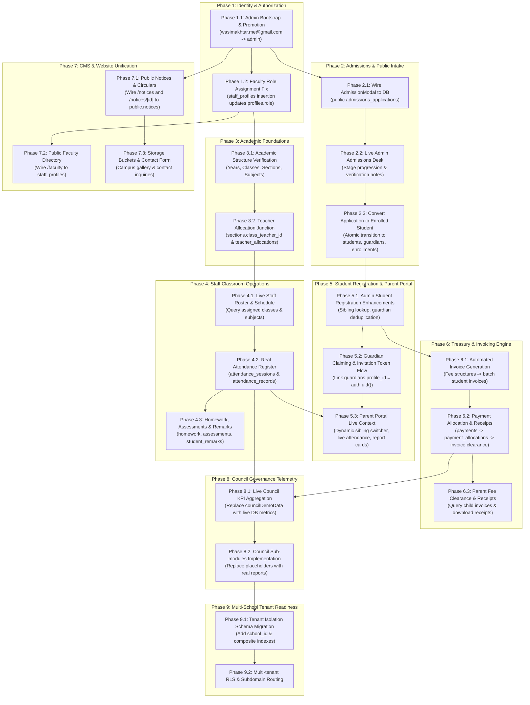

# Sainthia Shishutirtha — Production Implementation Roadmap

**Document Version:** 1.0.0  
**Date:** October 27, 2026  
**Auditor & Architect:** Antigravity (Advanced Agentic AI Assistant)  
**Target Repository:** `sainthiashishutirtha`  
**Current Tech Stack:** Next.js 16.4.2 (App Router, Turbopack, React 19.3.0), Supabase PostgreSQL (`tybaaqktbdlnqsgodkek`), Tailwind CSS v4, TypeScript 5  

---

## 1. Architectural Strategy & Guiding Principles

The Phase 0 Reality Audit established that while the UI design, component hierarchy, database schema, and RLS policies are in an advanced state of readiness, the application is currently split between live empty database endpoints (Admin Portal) and hardcoded static mocks (Admissions, Staff Portal, Parent Portal, Council Portal, Public Notices).

To bridge this chasm without breaking existing functionality or compromising security, the implementation must adhere to five non-negotiable architectural principles:

1. **Zero-Regression & Visual Integrity**: Preserve every existing public route, portal layout, responsive breakpoint, Tailwind CSS styling, and visual asset. Do not rewrite pages from scratch or discard working components.
2. **Single Source of Truth**: Replace hardcoded fixtures in `src/data/portal*.ts` and `src/data/schoolData.ts` with direct Supabase PostgREST client and server calls. All UI state must reflect actual PostgreSQL table contents.
3. **Honest Empty & Loading States**: When database tables contain zero records, portals must render clean, informative empty-state UI with direct call-to-action buttons rather than falling back to fake demo numbers or synthetic rows.
4. **RLS Policy Compliance**: All database mutations and queries must execute under the identity of the authenticated user (`auth.uid()`), strictly conforming to the 81 RLS policies established in `supabase/migrations/`. Never bypass RLS in client components.
5. **Atomic Stepwise Execution**: Each phase represents a self-contained, testable milestone that compiles cleanly (`npm run build`), passes linting (`npm run lint`), passes type checks (`npx tsc --noEmit`), and leaves the application in a fully functional state.

---

## 2. Master Implementation Dependency Graph

---

## 3. Detailed Phase Breakdown

### Phase 1: Identity, Admin Bootstrap & Role Promotion

**Primary Objective:** Ensure the school administrator account (`wasimakhtar.me@gmail.com`) possesses full admin privileges, and fix the onboarding bug where newly appointed teachers are trapped in the parent portal.

#### Target Files & Artifacts
* `src/app/portal/admin/faculty/page.tsx`
* `src/lib/services/adminService.ts`
* `supabase/migrations/20261027000001_fix_faculty_role_promotion.sql` (if DB function required)
* Target DB Tables: `public.profiles`, `public.staff_profiles`

#### Key Tasks
1. **Bootstrap Initial Administrator**:
   - Promote `wasimakhtar.me@gmail.com` in `public.profiles` from `role = 'parent'` to `role = 'admin'` using an authorized administrator bootstrap script or safe SQL migration that temporarily disables `guard_profile_role_update` or executes within an admin context.
   - Verify that upon logging in, the administrator is redirected directly to `/portal/admin`.
2. **Fix Faculty Onboarding Role Mutation**:
   - In `adminService.ts`, enhance `createStaffProfile()` to atomically update `public.profiles.role = 'staff'` alongside creating the `staff_profiles` record.
   - Add backend validation ensuring the referenced user exists in `profiles`.
3. **Admin User Management**:
   - Provide an admin UI in `/portal/admin/faculty` or `/portal/admin/users` to search registered users and grant `'staff'` or `'council'` roles.

#### Acceptance Criteria
- [ ] Administrator signs in and lands on `/portal/admin` with full read/write access.
- [ ] Admin creates/links a staff member; the user's `profiles.role` becomes `'staff'`.
- [ ] The staff member logs in and is correctly routed to `/portal/staff`, with access to teacher routes.

---

### Phase 2: Admissions & Public Intake Pipeline (End-to-End)

**Primary Objective:** Turn the public admissions modal into a functional lead generator that inserts directly into `admissions_applications`, wire the Admin Admissions Desk to the database, and implement one-click conversion into enrolled students.

#### Target Files & Artifacts
* `src/components/modals/AdmissionModal.tsx`
* `src/app/admissions/page.tsx`
* `src/app/portal/admin/admissions/page.tsx`
* `src/lib/services/admissionsService.ts` (new dedicated service)
* Target DB Tables: `public.admissions_applications`, `public.students`, `public.guardians`, `public.student_guardians`, `public.student_enrollments`

#### Key Tasks
1. **Public Intake Integration**:
   - Create `src/lib/services/admissionsService.ts` with client-safe submission function `submitPublicAdmissionApplication()`.
   - Update `AdmissionModal.tsx` to insert form data into `public.admissions_applications` via the Supabase client.
   - Display the server-generated sequence number (`application_number` e.g., `ADM-2026-00001`) in the success dialog instead of the random math string.
2. **Admin Admissions Desk Integration**:
   - Remove `ADMIN_ADMISSIONS_LIST` from `src/app/portal/admin/admissions/page.tsx`.
   - Fetch real applications via `getAdmissionsApplications({ stage, search })`.
   - Implement action buttons for stage transitions:
     - `Applied` -> `Document Verification` -> `Parent Interaction` -> `Provisional Admission` -> `Enrolled` / `Rejected`.
   - Implement reviewer assignment and review notes dialog.
3. **Application-to-Enrollment Conversion**:
   - Implement `convertApplicationToEnrolledStudent(applicationId, sectionId, rollNumber)`.
   - Atomically create:
     1. Student record in `public.students` using the applicant's details.
     2. Guardian record in `public.guardians` using the parent's contact info.
     3. Relationship in `public.student_guardians`.
     4. Cohort enrollment in `public.student_enrollments`.
     5. Update `admissions_applications.stage = 'Enrolled'`, `status = 'Enrolled'`.

#### Acceptance Criteria
- [ ] A prospective parent submits the public modal; a row appears in `admissions_applications` with a sequential `ADM-2026-XXXXX` number.
- [ ] The submission immediately appears in `/portal/admin/admissions` under the "Applied" filter.
- [ ] Admin can advance stages and record notes.
- [ ] Admin clicks "Admit & Enroll"; student, guardian, and enrollment records are created, and the student appears in `/portal/admin/students`.

---

### Phase 3: Academics Hierarchy & Teacher Allocations

**Primary Objective:** Enable class-teacher assignments and subject-teacher mapping so that the Staff Portal knows which classes and subjects belong to each logged-in teacher.

#### Target Files & Artifacts
* `src/app/portal/admin/academics/page.tsx`
* `src/lib/services/adminService.ts`
* Target DB Tables: `public.classes`, `public.sections`, `public.subjects`, `public.teacher_allocations`, `public.staff_profiles`

#### Key Tasks
1. **Class Teacher Assignment**:
   - Update `createSection()` and add `updateSection()` in `adminService.ts` to accept `class_teacher_id` (foreign key to `staff_profiles.id`).
   - Add a "Class Teacher" selector dropdown in `/portal/admin/academics` section creation and editing modals.
2. **Teacher Allocation Management**:
   - Implement `assignTeacherToSubject(staffId, sectionId, subjectId, academicYearId, role)`.
   - Build a "Faculty Subject Allocations" management tab in `/portal/admin/academics` allowing the admin to assign teachers to specific section-subject pairs (e.g., "Mr. Das -> Class 3A -> Mathematics").
   - Enforce database uniqueness constraints (`staff_id`, `section_id`, `subject_id`, `academic_year_id`).

#### Acceptance Criteria
- [ ] Admin assigns a Class Teacher to Section 1A; the relation is saved in `sections.class_teacher_id`.
- [ ] Admin assigns subject teachers to classes; rows are inserted into `public.teacher_allocations`.
- [ ] Live allocations are visible in the Academics management table.

---

### Phase 4: Staff (Teacher) Portal Live Classroom Operations

**Primary Objective:** Replace all mock data in the 6 Staff Portal subpages with live PostgREST queries filtered by the logged-in teacher's assigned classes and subjects.

#### Target Files & Artifacts
* `src/app/portal/staff/attendance/page.tsx`
* `src/app/portal/staff/homework/page.tsx`
* `src/app/portal/staff/assessments/page.tsx`
* `src/app/portal/staff/remarks/page.tsx`
* `src/app/portal/staff/classes/page.tsx`
* `src/lib/services/staffService.ts` (new dedicated service)
* Target DB Tables: `public.attendance_sessions`, `public.attendance_records`, `public.homework`, `public.assessments`, `public.student_marks`, `public.student_remarks`

#### Key Tasks
1. **Teacher Context & Assigned Cohorts**:
   - Create `src/lib/services/staffService.ts` with helper `getStaffTeachingContext(userId)` that resolves the logged-in user's `staff_profile_id`, assigned sections (as Class Teacher), and allocated subjects.
2. **Live Attendance Register**:
   - In `/portal/staff/attendance`, load the real student list for the selected section via `getEnrolledStudentsForSection(sectionId)`.
   - Wire the "Save Attendance Register" button to `submitDailyAttendance({ sectionId, date, records })`:
     - Creates or updates `attendance_sessions` with `recorded_by = auth.uid()`.
     - Upserts `attendance_records` for all students with statuses (`Present`, `Absent`, `Late`, `Half Day`).
   - Verify that attendance submitted by the teacher immediately reflects in the Admin Portal's `/portal/admin/attendance` dashboard.
3. **Homework Distribution**:
   - Replace `STAFF_HOMEWORK_LIST` in `/portal/staff/homework` with live queries against `public.homework`.
   - Wire "Assign Homework" modal to insert into `public.homework`.
4. **Assessments & Marks Entry**:
   - Connect `/portal/staff/assessments` to `public.assessments` and `public.student_marks`.
   - Allow teachers to enter test marks for students in their assigned sections.
5. **Student Remarks / Behavioral Observations**:
   - Connect `/portal/staff/remarks` to `public.student_remarks`, enabling teachers to log observations visible to parents.

#### Acceptance Criteria
- [ ] Teacher logs in and sees only their assigned classes and subjects.
- [ ] Teacher takes morning attendance and clicks Save; database records are created.
- [ ] Admin opens `/portal/admin/attendance` and sees the real submitted session and percentage.
- [ ] Teacher creates a homework task; it is persisted in `public.homework`.

---

### Phase 5: Student Registration, Guardian Claiming & Parent Portal Activation

**Primary Objective:** Allow parents to securely link their Auth accounts to their children's records, activate dynamic multi-child switching, and display live school records in the Parent Portal.

#### Target Files & Artifacts
* `src/app/portal/admin/students/page.tsx`
* `src/components/portal/parent/ParentContext.tsx`
* `src/app/portal/parent/attendance/page.tsx`
* `src/app/portal/parent/fees/page.tsx`
* `src/app/portal/parent/homework/page.tsx`
* `src/app/portal/parent/report-cards/page.tsx`
* `src/lib/services/parentService.ts` (new dedicated service)
* Target DB Tables: `public.guardians`, `public.guardian_invitations`, `public.student_guardians`, `public.students`

#### Key Tasks
1. **Guardian Invitation & Account Claiming**:
   - Create table/flow for guardian account claiming: when an admin registers a student with parent email/phone, generate a claim token or allow the parent to register/sign in with that matching email.
   - Implement secure RPC function `claim_guardian_profile(invitation_token)` or verify on sign-in:
     - Sets `guardians.profile_id = auth.uid()`.
     - Sets `guardians.verification_status = 'verified'`.
   - This satisfies RLS helper `is_guardian_of(student_id)`:
     `g.profile_id = auth.uid() AND g.verification_status = 'verified'`.
2. **Dynamic Sibling Switcher (`ParentContext.tsx`)**:
   - Remove hardcoded `Aarav Sen` and `Ananya Sen`.
   - Query `public.student_guardians` joined with `public.students` and `public.student_enrollments` for all children where `guardian.profile_id = auth.uid()`.
   - Populate the active child dropdown with real children. If 0 children are linked, show an onboarding prompt to enter the admission claim code.
3. **Live Parent Views**:
   - `/portal/parent/attendance`: Query child's real attendance records from `public.attendance_records`.
   - `/portal/parent/homework`: Query homework for the child's enrolled section from `public.homework`.
   - `/portal/parent/report-cards`: Query marks from `public.student_marks`.
   - `/portal/parent/notices`: Query circulars from `public.notices` where `target_audience IN ('All', 'Parents')`.

#### Acceptance Criteria
- [ ] A parent logs in; `ParentContext` fetches the parent's actual enrolled children from Supabase.
- [ ] Switching children dynamically re-fetches attendance, homework, and fees for that child.
- [ ] Attendance marked by the teacher in Phase 4 is immediately visible to the parent.
- [ ] RLS prevents Parent A from viewing records belonging to Parent B's children.

---

### Phase 6: Treasury, Invoicing Engine & Fee Realization

**Primary Objective:** Automatically generate invoices from defined fee structures for enrolled students, record payments with proper line-item allocations, and let parents view and clear fees.

#### Target Files & Artifacts
* `src/app/portal/admin/finance/page.tsx`
* `src/app/portal/parent/fees/page.tsx`
* `src/lib/services/financeService.ts` (new dedicated service)
* Target DB Tables: `public.fee_structures`, `public.fee_structure_items`, `public.invoices`, `public.invoice_items`, `public.payments`, `public.payment_allocations`

#### Key Tasks
1. **Batch Invoicing Engine**:
   - Implement `generateInvoicesForCohort({ academicYearId, classId, feeStructureId, dueDate, title })`:
     - Queries all active students in `student_enrollments` for that class.
     - For each student, inserts an `invoices` row and copies the fee items into `invoice_items`.
     - Sets invoice initial status to `'Issued'`.
2. **Payment Allocation & Status Reconciliation**:
   - Enhance `recordPayment()` in `adminService.ts`:
     - When an admin collects cash/UPI/cheque at the counter, allocate payment against the student's open invoices via `public.payment_allocations`.
     - Update invoice `paid_amount` and transition status (`Issued` -> `Partially Paid` -> `Paid`).
3. **Parent Fee Portal & Receipt Generation**:
   - Connect `/portal/parent/fees` to query `public.invoices` for the active child.
   - Display clear status badges (Paid, Pending, Overdue).
   - Provide a printable/downloadable PDF-ready HTML fee receipt modal.

#### Acceptance Criteria
- [ ] Admin defines a fee structure (e.g., "Term 1 Tuition: ₹1,500") and clicks "Generate Cohort Invoices".
- [ ] Invoices are created for all students enrolled in that class.
- [ ] The parent logs in and sees the pending invoice under `/portal/parent/fees`.
- [ ] Admin records counter payment; the invoice status transitions to `'Paid'`, and the parent sees the receipt.

---

### Phase 7: CMS & Website Unification

**Primary Objective:** Eliminate static content silos so that public notices, faculty listings, gallery photos, and contact messages are synchronized with the database.

#### Target Files & Artifacts
* `src/app/notices/page.tsx`
* `src/app/notices/[id]/page.tsx`
* `src/app/faculty/page.tsx`
* `src/app/gallery/page.tsx`
* `src/app/contact/page.tsx`
* `src/app/portal/admin/website/page.tsx`
* Target DB Tables: `public.notices`, `public.staff_profiles`, `public.contact_inquiries` (or equivalent)

#### Key Tasks
1. **Public Noticeboard Sync**:
   - Refactor `src/app/notices/page.tsx` and `src/app/notices/[id]/page.tsx` to query `public.notices` where `is_published = true` and `published_at <= NOW()`.
   - Maintain static fallback or ISR (Incremental Static Regeneration) for high-performance delivery.
   - Ensure notices published via `/portal/admin/website` appear immediately on the public website.
2. **Public Faculty Sync**:
   - Refactor `src/app/faculty/page.tsx` to query `public.staff_profiles` joined with `public.profiles`.
   - Display verified faculty members with their designations, qualifications, and profile pictures.
3. **Public Contact Inquiries**:
   - Create table `public.contact_inquiries` with public RLS insert policy.
   - Wire `src/app/contact/page.tsx` to insert inquiries into the database, and display incoming messages in `/portal/admin/website`.

#### Acceptance Criteria
- [ ] Admin publishes an urgent notice in the admin portal; it appears on `/notices` and the home page carousel immediately.
- [ ] Admin adds a new teacher; they appear in the public faculty directory.
- [ ] Visitor submits the contact form; inquiry is recorded in the admin inbox.

---

### Phase 8: Council Governance Telemetry

**Primary Objective:** Replace the hardcoded metrics and placeholder screens in the Council Portal with genuine, live-aggregated administrative telemetry.

#### Target Files & Artifacts
* `src/app/portal/council/page.tsx`
* `src/app/portal/council/[module]/page.tsx`
* `src/lib/services/councilService.ts` (new dedicated service)
* Target DB Tables: Aggregates across `students`, `staff_profiles`, `attendance_records`, `payments`, `admissions_applications`

#### Key Tasks
1. **Live Executive KPI Telemetry**:
   - Implement `getCouncilDashboardMetrics()` in `councilService.ts` querying live counts and financial totals:
     - Total Enrolled Students (from `student_enrollments`)
     - Total Faculty (from `staff_profiles`)
     - Today's Overall Campus Attendance Percentage (from `attendance_records`)
     - Year-to-Date Fee Realization (from `payments`)
     - Open Admissions Inquiries (from `admissions_applications`)
   - Replace `COUNCIL_KPIS` in `/portal/council/page.tsx`.
2. **Replace Placeholder Submodules**:
   - Implement real read-only governance views for:
     - `/portal/council/academics`: Class-wise enrollment distribution and student-teacher ratios.
     - `/portal/council/finance`: Monthly collection summaries and outstanding dues.
     - `/portal/council/admissions`: Conversion funnel metrics.
     - `/portal/council/resolutions`: Committee meeting minutes and institutional resolutions.

#### Acceptance Criteria
- [ ] Council dashboard displays exact numbers that match the Admin Portal's live data.
- [ ] No placeholder components or fake statistics remain in the Council Portal.

---

### Phase 9: Multi-School Tenant Isolation Readiness

**Primary Objective:** Prepare the database schema, RLS policies, and routing for multi-tenant isolation, ensuring the system can support multiple school campuses without data leaks.

#### Target Files & Artifacts
* `supabase/migrations/20261101000001_multi_school_tenancy.sql`
* `src/lib/auth/tenantContext.ts`
* `src/proxy.ts`
* Target DB Tables: `public.schools`, plus all 32 existing tables

#### Key Tasks
1. **Tenant Schema Migration**:
   - Create `public.schools` (`id`, `slug`, `name`, `domain`, `is_active`, `settings`).
   - Add `school_id UUID NOT NULL REFERENCES public.schools(id)` to all 32 application tables.
   - Create composite indices on `(school_id, ...)` across high-frequency tables.
2. **Tenant RLS Hardening**:
   - Update RLS helper `current_user_school_id()` to extract tenant from user metadata or profile.
   - Augment all 81 RLS policies with `WHERE school_id = current_user_school_id()`.
3. **Subdomain / Path Routing Resolution**:
   - Configure Next.js middleware in `proxy.ts` to detect tenant from subdomain or request header.

#### Acceptance Criteria
- [ ] Database supports multiple schools with isolated rows.
- [ ] Users from School A cannot access or query any data belonging to School B.

---

## 4. Comprehensive Acceptance & Verification Matrix

| Workflow / User Journey | Verification Steps | Pass / Fail Condition |
| :--- | :--- | :--- |
| **Admin Bootstrap** | Sign in as `wasimakhtar.me@gmail.com` | Lands on `/portal/admin` with HTTP 200, no redirect to parent portal |
| **Public Admission Submission** | Submit form on `/admissions` | Row created in `admissions_applications` with sequential `ADM-2026-XXXXX` |
| **Admin Admissions Review** | Open `/portal/admin/admissions` | Application visible; status changed to `Parent Interaction` |
| **Student Enrollment Conversion** | Click "Admit & Enroll" on application | Records inserted into `students`, `guardians`, `student_guardians`, `student_enrollments` |
| **Teacher Allocation** | Assign Class Teacher in `/portal/admin/academics` | `sections.class_teacher_id` updated; visible in allocations table |
| **Staff Attendance Roll Call** | Teacher opens `/portal/staff/attendance` and saves register | Session and student records created in `attendance_sessions` and `attendance_records` |
| **Admin Attendance Telemetry** | Open `/portal/admin/attendance` | Real-time percentage matches teacher submission |
| **Parent Portal Sibling Link** | Parent signs in; opens `/portal/parent` | Children dropdown shows real enrolled children; attendance reflects teacher roll call |
| **Fee Invoicing & Payment** | Admin generates term fee; records counter payment | Invoice generated -> parent sees pending -> admin records payment -> invoice marked Paid |
| **Public Noticeboard Sync** | Admin publishes notice in `/portal/admin/website` | Notice appears immediately on `/notices` and home page carousel |
| **Council KPI Sync** | Open `/portal/council` | KPIs dynamically reflect exact database counts, not fake 342/22 numbers |
| **Codebase Integrity** | Run `npx tsc --noEmit && npm run lint && npm run build` | 0 errors, 0 warnings, all 62+ routes compile cleanly |

---

## 5. Rollback & Safety Guardrails

1. **Version Control Branching**:
   - Each implementation phase must be developed on a dedicated feature branch:
     `feat/phase-1-identity`, `feat/phase-2-admissions`, `feat/phase-3-academics`, etc.
   - Code is merged to `main` only after passing `tsc`, `lint`, and `build` checks.
2. **Reversible SQL Migrations**:
   - Any database schema change must include both an `UP` migration file and a corresponding `DOWN` rollback script.
   - Never run `supabase db push` against production without verifying locally and reviewing a `--dry-run` diff.
3. **Graceful UI Fallbacks**:
   - When transitioning pages from mock data to live data, implement fallback UI states (spinners, empty cards, retry buttons) rather than allowing unhandled promise rejections to crash the Next.js React tree.
4. **Credential Security**:
   - Strictly prohibit hardcoding Supabase Service Role keys, database connection strings, or user credentials in any client-side file. All sensitive mutations must be performed via authenticated PostgREST calls respecting RLS or secure Server Actions.
