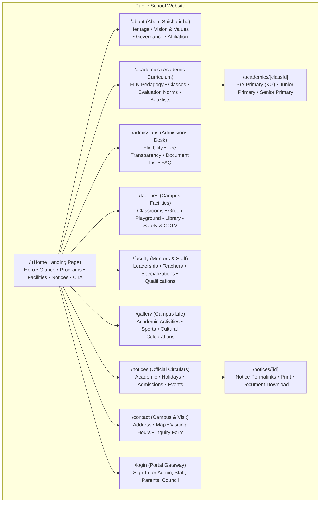
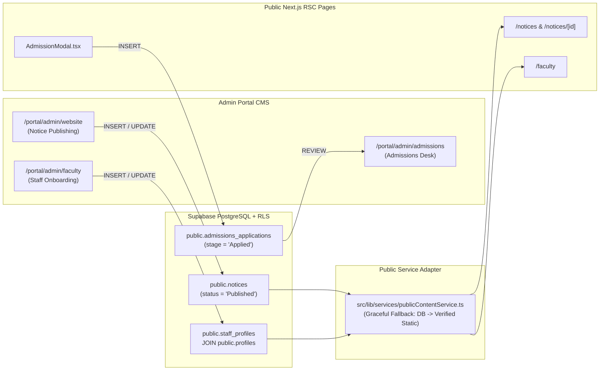
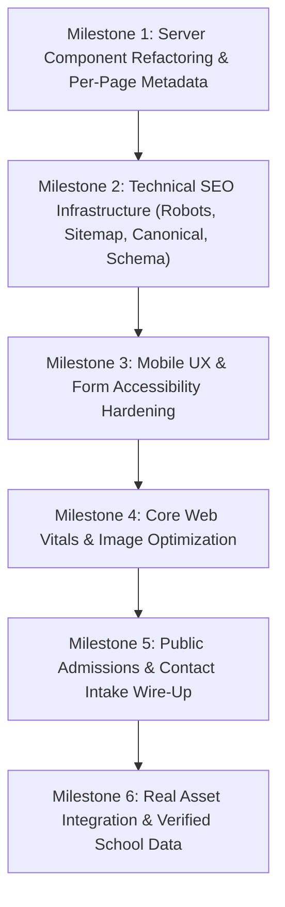

# Sainthia Shishutirtha — Public Website Quality & Implementation Plan

**Document Version:** 1.0.0  
**Date:** October 27, 2026  
**Auditor & Lead Architect:** Antigravity (Advanced Agentic AI Assistant)  
**Project Workspace:** `D:\sainthiashishutirtha`  
**Current Tech Stack:** Next.js 16.4.2 (App Router, Turbopack, React 19.3.0), Supabase PostgreSQL (`tybaaqktbdlnqsgodkek`), Tailwind CSS v4, TypeScript 5  

---

## 1. Verified Current Website Status

An exhaustive inspection of the existing public-facing code across `src/app/`, `src/components/`, and `src/data/` reveals an aesthetically modern, cohesive, and feature-rich front-of-house that is currently constrained by client-side rendering bottlenecks and static data silos:

### 1.1 Page & Route Inventory
The public website currently encompasses 11 routes:
* **`/` (Home Landing Page)** (`src/app/page.tsx`): Composed of 12 modular sections including Hero, School at a Glance, Welcome Message, About Overview, Academic Programs, Facilities Showcase, Why Choose Us, Photo Gallery Preview, Announcements, Admissions CTA, Contact & Campus Location, and Quick Action Rail.
* **`/about` (About Institution)** (`src/app/about/page.tsx`): Heritage, vision, mission, pedagogical philosophy (joyful foundational learning), and governing council overview.
* **`/academics` (Academic Curriculum)** (`src/app/academics/page.tsx`): Educational stages (Pre-Primary, Junior Primary, Senior Primary), FLN pedagogy, grading norms, and syllabus download placeholders.
* **`/academics/[classId]` (Grade Deep Dive)** (`src/app/academics/[classId]/page.tsx`): Static parameters for `pre-primary-kg`, `junior-primary`, and `senior-primary` detailing daily routines, curriculum breakdowns, and booklists.
* **`/admissions` (Admissions Information & Guidelines)** (`src/app/admissions/page.tsx`): Age criteria, fee transparency overview, application steps, document checklists, and FAQ accordion.
* **`/facilities` (Campus Infrastructure)** (`src/app/facilities/page.tsx`): 6 infrastructure categories (Smart Classrooms, Safe Playground, Junior Library, Arts Studio, Sanitation/CCTV, Digital Lab).
* **`/faculty` (Faculty & Mentors)** (`src/app/faculty/page.tsx`): Department filters (`Leadership`, `Primary`, `Pre-Primary`, `Activity`) with 8 faculty mentor profiles.
* **`/gallery` (Campus Life Gallery)** (`src/app/gallery/page.tsx`): Photo grid with category filters and interactive modal lightbox.
* **`/notices` (Public Noticeboard)** (`src/app/notices/page.tsx`): Searchable and filterable official circulars, event dates, and holiday notices.
* **`/notices/[id]` (Single Notice Reader)** (`src/app/notices/[id]/page.tsx`): Static detail view for individual circulars with print action.
* **`/contact` (Contact & Location)** (`src/app/contact/page.tsx`): Campus address, office timings, phone helplines, interactive visitor enquiry form, and simulated map.

### 1.2 Identified Technical & Architectural Bottlenecks
1. **Pervasive `'use client'` Directives**:
   * 10 out of the 11 public pages (`/`, `/about`, `/academics`, `/admissions`, `/facilities`, `/faculty`, `/gallery`, `/notices`, `/contact`) are marked with `'use client'`.
   * **Root Cause:** Each page independently instantiates `const [isModalOpen, setIsModalOpen] = useState(false)` to control the `AdmissionModal` dialog and passes it down to navigation bars and buttons.
   * **Consequence:** Next.js prohibits `export const metadata: Metadata` in client components. As a result, **none of these pages have unique `<title>`, `<meta description>`, or Open Graph tags**. The entire website inherits a single generic title from `src/app/layout.tsx`. Furthermore, shipping client components for purely static text and cards significantly inflates the JavaScript bundle size on mobile devices.
2. **Missing Search Engine Infrastructure**:
   * No `robots.txt` or `src/app/robots.ts` exists in the repository.
   * No `sitemap.xml` or `src/app/sitemap.ts` exists.
   * No Schema.org JSON-LD structured data (`School` or `EducationalOrganization`) is implemented.
   * No canonical URL tags are generated.
3. **Image Delivery & Asset Sourcing**:
   * Except for the school seal (`public/logo.png`), **100% of campus, classroom, facility, and faculty photographs are remote Unsplash placeholder images**.
   * While `next.config.ts` allows `images.unsplash.com`, remote placeholders prevent genuine institutional branding and can introduce DNS latency or remote rate limits.
   * Above-the-fold images in the Hero section lack explicit fetch priority optimizations for mobile LCP.
4. **Form Submissions Are Disconnected**:
   * The public `AdmissionModal.tsx` generates a random math string (`ST-2026-XXXX`) and discards user data in local React state.
   * The `/contact` form sets `isSubmitted = true` in React state without persisting the enquiry to a database or triggering notification emails.
5. **Accessibility Gaps**:
   * Form inputs in `AdmissionModal.tsx` and `ContactPage.tsx` lack explicit `id` attributes linked to their corresponding `<label htmlFor="...">` tags.
   * Autocomplete hints (`autocomplete="name"`, `autocomplete="tel"`, `autocomplete="email"`) are missing, degrading mobile form completion.

---

## 2. Recommended Page Structure & Information Architecture

The website's structure must convey academic credibility, safety, transparency, and warmth for prospective parents while serving current school families efficiently.



### Strategic Section Enhancements
* **Primary Navigation (`Navbar.tsx`)**:
  * Clean, sticky header with verified phone helpline and school hours in the top utility bar.
  * Direct, prominent action: *"Apply for Admission"* (primary accent button) and *"Portal Login"* (secondary subtle button).
* **Homepage Hierarchy**:
  1. *Hero Section*: High-trust headline, official registration badge (`Govt. Regd S/2L/14754`, `U-DISE: 19082200103`), primary CTA ("Explore Admissions"), and secondary CTA ("Discover Our School").
  2. *School at a Glance*: 4 immediate metrics: 18:1 Student-Teacher Ratio, Estd. 2013, KG to Class IV focus, 100% child-safe CCTV campus.
  3. *Welcome Message*: Heartfelt message from the Headmistress/Founder emphasizing fear-free, joyful early childhood education.
  4. *Academic Wings*: Clear visual cards for Pre-Primary/KG, Junior Primary (I & II), Senior Primary (III & IV).
  5. *Latest Notices Ticker*: Immediate awareness of current admissions or holiday schedules.
  6. *Campus Life & Safety*: Focus on sanitation, drinking water, green playground, and dedicated female attendants for younger children.
  7. *Location & Contact*: Clear Sainthia town landmarks, railway station proximity, and visit hours.

---

## 3. UX and Mobile Strategy

Over 75% of prospective parents in regional West Bengal access the school website via smartphones on mobile 4G/5G networks. The user experience must be frictionless, immediate, and accessible:

### 3.1 Mobile-First Viewport Adaptations
* **Tap Targets**: All buttons, navigation items, accordion toggles, and form inputs must meet the WCAG 2.2 target size of **at least 48 × 48 CSS pixels** with adequate spacing to prevent mistaps.
* **Persistent Mobile Action Rail (`QuickActionRail.tsx`)**:
  * A fixed, unobtrusive bottom navigation bar on mobile viewports (< 768px) with 4 high-intent actions:
    1. `Call Campus` (`tel:+91...`)
    2. `Apply Online` (opens admission modal)
    3. `Directions` (opens verified Google Maps location)
    4. `Parent Portal` (direct link to `/login`)
* **Mobile Drawer Navigation**:
  * Slide-out drawer with high-contrast text, clear category dividers, and an instant close button.
  * Auto-closes on route changes and disables background body scroll while active.

### 3.2 Visual Design & Accessibility (a11y)
* **High-Contrast Palette**:
  * Background: Pure White (`#FFFFFF`) and Soft Slate (`#F8FAFC`).
  * Primary Brand: Deep Forest Teal (`#243B43`) — contrast ratio > 10:1 against white (WCAG AAA).
  * Supporting Accent: Bright Ocean Teal (`#308599`) and Sky Blue (`#A5D1DC`).
  * Text Colors: Slate 800 (`#1E293B`) for body text, ensuring effortless reading under sunlight.
* **Typography Ramp**:
  * `Plus_Jakarta_Sans` variable font with strict `font-display: swap`.
  * Base text size of 16px (`1rem`) on inputs to prevent iOS Safari auto-zooming on focus.
  * Minimum line height of 1.6 for body copy and 1.25 for headings.
* **Form UX & Validation**:
  * Explicit `<label>` association: Every input must have a corresponding `<label htmlFor="field-id">`.
  * Proper input types: `type="tel" inputMode="tel"` for mobile numbers, `type="email"` for email, `type="date"` for date of birth.
  * Real-time inline feedback: Informative validation messages for invalid phone numbers (10 digits) without jarring layout jumps.
* **Accessible Focus States**:
  * Highly visible, 2px focus rings (`focus-visible:ring-2 focus-visible:ring-[#308599] focus-visible:outline-hidden`) on all interactive buttons, links, and form fields for keyboard navigation.
  * Skip to Main Content link (`<a href="#main-content" className="sr-only focus:not-sr-only ...">`) at the top of the DOM.

---

## 4. Performance Optimization Plan (Targeting Core Web Vitals)

Targeting strict performance metrics ensures fast load times on budget mobile devices and spotty connectivity:

| Core Web Vital | Metric Target | Optimization Strategy |
| :--- | :--- | :--- |
| **Largest Contentful Paint (LCP)** | **≤ 2.5 seconds** | Refactor pages to Server Components; eliminate client-side hydration delays; optimize Hero image with `fetchPriority="high"` and Next.js image optimization; self-host or preconnect fonts. |
| **Interaction to Next Paint (INP)** | **≤ 200 milliseconds** | Remove heavy client JavaScript; isolate modal state into small leaf components; avoid long JavaScript execution during button clicks; avoid layout recalculations. |
| **Cumulative Layout Shift (CLS)** | **≤ 0.1** | Define explicit width and height aspect ratios on all image containers (`aspect-[4/3]`, `aspect-[16/9]`); reserve space for notice lists and banners; use CSS `font-display: swap` with size-adjust. |

### 4.1 React Server Components (RSC) Architectural Shift
* **The Problem**: Currently, marking `/`, `/about`, `/academics`, etc. with `'use client'` forces the browser to download, parse, and execute React code for entire static marketing sections before the page becomes interactive.
* **The Solution**:
  1. Remove `'use client'` from all top-level public pages (`src/app/*/page.tsx`).
  2. Move interactive modal state (`isModalOpen`) to a client-side leaf component or URL search parameter (e.g., navigating to `/admissions?apply=true` or clicking a lightweight `<AdmissionModalTrigger />` island).
  3. Allow Next.js to render static HTML on the server, drastically reducing client JS execution time and providing instant First Contentful Paint (FCP).

### 4.2 Image Optimization Strategy
* **Next.js `<Image>` Optimization**:
  * Utilize Next.js automatic WebP/AVIF generation, responsive `srcset`, and size downsampling.
  * All images must specify the `sizes` attribute matching their responsive container (e.g., `sizes="(max-width: 768px) 100vw, 50vw"`).
* **Hero Image Prioritization**:
  * Add `priority` and `fetchPriority="high"` to the above-the-fold Hero banner image.
  * Preload the Hero image candidate in `<head>`.
* **Below-the-fold Deferred Loading**:
  * Ensure all images in `/facilities`, `/faculty`, and `/gallery` use native lazy loading (`loading="lazy"`).
  * Use skeleton placeholder wrappers with fixed aspect ratios to guarantee **zero layout shift**.

### 4.3 Asset & Dependency Hygiene
* Audit `package.json` to ensure zero heavy animation libraries (e.g., Framer Motion or GSAP) are imported on the public marketing bundle.
* Use lightweight CSS-only transitions and standard HTML5 dialogs for popups and drawers.

---

## 5. SEO and Google Ranking Implementation Plan

To establish strong organic discoverability for parents searching in Sainthia, Birbhum, and neighboring areas (Suri, Bolpur, Rampurhat, Ahmedpur), we must build robust technical and local on-page SEO without gimmicks or false claims.

### 5.1 Technical SEO Infrastructure
1. **Robots Configuration (`src/app/robots.ts`)**:
   ```typescript
   import { MetadataRoute } from 'next';

   export default function robots(): MetadataRoute.Robots {
     return {
       rules: [
         {
           userAgent: '*',
           allow: '/',
           disallow: [
             '/portal/',
             '/portal/*',
             '/admin/',
             '/parent/',
             '/api/',
             '/auth/',
           ],
         },
       ],
       sitemap: 'https://www.sainthiashishutirtha.org/sitemap.xml',
     };
   }
   ```
2. **Dynamic XML Sitemap (`src/app/sitemap.ts`)**:
   * Automatically generates entries for all core public pages (`/`, `/about`, `/academics`, `/admissions`, `/facilities`, `/faculty`, `/gallery`, `/notices`, `/contact`).
   * Dynamically includes academic grade routes (`/academics/pre-primary-kg`, etc.) and published notice permalinks (`/notices/[slug]`).
3. **Canonical URLs & Open Graph**:
   * Define `metadataBase: new URL('https://www.sainthiashishutirtha.org')` in `src/app/layout.tsx`.
   * Configure `alternates: { canonical: './' }` across all pages to prevent duplicate content indexing.
   * Provide high-resolution Open Graph image (`1200 × 630 px`) for WhatsApp, Facebook, and Twitter link previews.

### 5.2 Unique Per-Page Metadata Matrix

| Page Route | Proposed `<title>` | Proposed `<meta description>` | Target Search Intent |
| :--- | :--- | :--- | :--- |
| **`/`** | Sainthia Shishutirtha | Foundational & Primary School (KG to Class IV) | Official website of Sainthia Shishutirtha, Birbhum, WB. Joyful early childhood & primary education (KG–Class IV). Govt. Regd & U-DISE certified. | Brand & local primary school search |
| **`/about`** | About Us & Educational Philosophy | Sainthia Shishutirtha | Discover the heritage, pedagogical values, and governing committee of Sainthia Shishutirtha, nurturing foundational learning since 2013 in Birbhum. | Institutional trust & governance |
| **`/academics`** | Academic Curriculum & Early Literacy | Sainthia Shishutirtha | Comprehensive foundational curriculum from Kindergarten to Class IV. Play-based learning, bilingual fluency (Bengali & English), and FLN numeracy. | Academic quality & syllabus |
| **`/admissions`** | Admission Guidelines & Eligibility (2025–26) | Sainthia Shishutirtha | Admission criteria, age eligibility, document requirements, and online enquiry for Kindergarten through Class IV at Sainthia Shishutirtha. | Admissions & intake search |
| **`/facilities`** | Campus Infrastructure, Playground & Safety | Sainthia Shishutirtha | Explore our child-friendly classrooms, spacious green playground, junior library, CCTV security, and hygienic sanitation in Sainthia town. | Campus safety & amenities |
| **`/faculty`** | Qualified Mentors & Teaching Faculty | Sainthia Shishutirtha | Meet our dedicated primary and early childhood educators trained in compassionate communication, child psychology, and foundational pedagogy. | Faculty qualifications |
| **`/gallery`** | Campus Life & Cultural Photo Gallery | Sainthia Shishutirtha | Visual showcase of student activities, sports day, annual celebrations, art exhibitions, and everyday learning at Sainthia Shishutirtha. | Visual campus life |
| **`/notices`** | Official Notices, Circulars & Announcements | Sainthia Shishutirtha | Latest school notices, academic circulars, admission notifications, and holiday lists for Sainthia Shishutirtha parents and guardians. | Current notices & calendar |
| **`/contact`** | Campus Location, Office Hours & Contact | Sainthia Shishutirtha | Visit our Sainthia campus. Get verified phone numbers, visiting hours, railway station directions, and submit admission visit requests. | Local contact & directions |

### 5.3 Structured Data (Schema.org JSON-LD)
Implement a reusable component (`src/components/common/JsonLd.tsx`) injecting verified structured data:
* **EducationalOrganization / School Schema**:
  ```json
  {
    "@context": "https://schema.org",
    "@type": "School",
    "name": "Sainthia Shishutirtha",
    "alternateName": "Shishutirtha Sainthia",
    "description": "Foundational and primary school providing Kindergarten to Class IV education in Sainthia, Birbhum, West Bengal.",
    "url": "https://www.sainthiashishutirtha.org",
    "logo": "https://www.sainthiashishutirtha.org/logo.png",
    "telephone": "+91-94740-12345",
    "email": "info@sainthiashishutirtha.org",
    "address": {
      "@type": "PostalAddress",
      "streetAddress": "Sainthia Town",
      "addressLocality": "Sainthia",
      "addressRegion": "West Bengal",
      "postalCode": "731234",
      "addressCountry": "IN"
    },
    "hasCredential": [
      {
        "@type": "EducationalOccupationalCredential",
        "credentialCategory": "U-DISE Code",
        "name": "19082200103"
      },
      {
        "@type": "EducationalOccupationalCredential",
        "credentialCategory": "Government Registration",
        "name": "S/2L/14754 OF 2013-14"
      }
    ]
  }
  ```
* **BreadcrumbList Schema**: On subpages (`/about`, `/academics`, `/admissions`, etc.) enabling rich snippet breadcrumbs in Google Search results.

### 5.4 Ethical Local SEO Standards
* Strictly adhere to Google Search Essentials:
  * **No fake reviews or testimonials**: Only include genuine parent testimonials with confirmed consent.
  * **No keyword stuffing**: Natural, descriptive language emphasizing early childhood education in Birbhum.
  * **Accurate local NAP**: Identical Name, Address, and Phone numbers across the site footer, contact page, and Google Business Profile.

---

## 6. Future CMS & Admin Portal Integration Approach

The public website must be engineered so that when the Admin Portal's CMS features are fully activated, the public site begins consuming live database content automatically without requiring redesigns or component refactoring.



### 6.1 Architectural Decoupling: The Public Content Service Layer
Create a dedicated read service: `src/lib/services/publicContentService.ts`.
This service implements the **Fallback Adapter Pattern**:
1. When queried, it attempts to fetch live published records from Supabase using the public PostgREST client:
   * `getPublishedNotices()` queries `public.notices` where `status = 'Published'` and `target_audience IN ('All', 'Public')`.
   * `getPublicFaculty()` queries `public.staff_profiles` joined with `public.profiles`.
2. If the Supabase query returns records, they are rendered dynamically.
3. If the table returns 0 records (e.g., during initial setup) or encounters a network issue, it **gracefully falls back to verified static data**, ensuring the website never renders broken or blank pages.

### 6.2 Admissions Intake Flow
* Wire `AdmissionModal.tsx` and the `/contact` enquiry form to `public.admissions_applications` via a client-side submission handler:
  ```typescript
  // Inserts directly into admissions_applications conforming to RLS
  const { data, error } = await supabase
    .from('admissions_applications')
    .insert({
      academic_year_id: currentYearId,
      applied_class_id: classId,
      candidate_first_name: firstName,
      candidate_last_name: lastName,
      date_of_birth: dob,
      gender: gender,
      guardian_name: parentName,
      guardian_phone: phone,
      guardian_email: email || null,
      residential_address: address,
      stage: 'Applied',
      status: 'Pending Review'
    })
    .select('application_no')
    .single();
  ```
* The database trigger `trg_handle_admissions_application_insert` automatically generates a real, sequential application number (e.g., `ADM-2026-01001`).
* The user immediately receives their official confirmation number on screen, and the record appears in `/portal/admin/admissions` for administrative review.

### 6.3 Absolute Data Isolation Guarantee
* **Public RLS Enforcement**: Public visitors only have `SELECT` grants on `public.notices` (where `status = 'Published'`) and `INSERT` grants on `public.admissions_applications`.
* **Zero Private Data Exposure**: Under no circumstances will student rosters, attendance roll calls, report cards, teacher payroll, or parent guardian records be accessible to public visitors.
* **No Service Role Keys**: The public client bundle will never include `SUPABASE_SERVICE_ROLE_KEY`.

---

## 7. Small Implementation Milestones with Acceptance Criteria

To guarantee safety, stability, and zero regressions, the implementation is broken into 6 tightly scoped, sequential milestones:



### Milestone 1: Server Component Refactoring & Per-Page Metadata
* **Objective:** Decouple `AdmissionModal` state from top-level page components, eliminate `'use client'` on all 10 marketing routes, and export unique, descriptive `Metadata` on every page.
* **Key Tasks:**
  1. Create a client-side wrapper or URL parameter trigger for `AdmissionModal` so pages don't need top-level React state.
  2. Remove `'use client'` from `/`, `/about`, `/academics`, `/admissions`, `/facilities`, `/faculty`, `/gallery`, `/notices`, and `/contact`.
  3. Define custom `export const metadata: Metadata` on every route with unique title, description, and keywords.
* **Acceptance Criteria:**
  - [ ] `npm run build` succeeds with all public routes compiled as static Server Components.
  - [ ] Inspecting the raw HTML of each page reveals its unique `<title>` and `<meta name="description">`.
  - [ ] Opening the admissions modal from buttons on any page continues to work flawlessly.

### Milestone 2: Technical SEO Infrastructure
* **Objective:** Establish automated search engine indexing rules and structured data.
* **Key Tasks:**
  1. Create `src/app/robots.ts` disallowing `/portal/` and pointing to the sitemap.
  2. Create `src/app/sitemap.ts` dynamically mapping all static routes and active class details.
  3. Create `src/components/common/JsonLd.tsx` injecting `School` and `BreadcrumbList` schemas.
* **Acceptance Criteria:**
  - [ ] `http://localhost:3000/robots.txt` returns HTTP 200 with correct disallow directives.
  - [ ] `http://localhost:3000/sitemap.xml` returns valid XML listing all public URLs.
  - [ ] Schema markup validates cleanly on the Google Rich Results Test without warnings.

### Milestone 3: Mobile UX & Form Accessibility Hardening
* **Objective:** Achieve full WCAG 2.2 AA accessibility and thumb-friendly mobile ergonomics.
* **Key Tasks:**
  1. Add explicit `id` and `htmlFor` to all form inputs in `AdmissionModal.tsx` and `ContactPage.tsx`.
  2. Add `autoComplete` and `inputMode` attributes.
  3. Add a "Skip to Content" accessibility link in `src/app/layout.tsx`.
  4. Verify that touch targets across buttons and drawer links are ≥ 48px.
* **Acceptance Criteria:**
  - [ ] Complete keyboard navigation through every form and modal using `Tab` and `Enter`.
  - [ ] Screen readers correctly announce field labels when focusing inputs.
  - [ ] Zero layout shifts when opening or closing the mobile navigation drawer.

### Milestone 4: Core Web Vitals & Image Optimization
* **Objective:** Maximize loading speed and visual stability on slow mobile connections.
* **Key Tasks:**
  1. Add `priority` and `fetchPriority="high"` to the homepage hero image.
  2. Add fixed aspect-ratio wrapper constraints (`aspect-[4/3]`, `aspect-[16/9]`) on all cards.
  3. Configure optimal responsive `sizes` attributes for all `<Image />` tags.
  4. Ensure font display utilizes `swap` without invisible text flash (FOIT).
* **Acceptance Criteria:**
  - [ ] Visual inspection verifies no layout shifts during image loading (CLS < 0.1).
  - [ ] Hero image starts downloading immediately in the waterfall before other sub-assets.
  - [ ] `npx tsc --noEmit` and `npm run lint` report 0 errors.

### Milestone 5: Public Admissions & Contact Intake Wire-Up
* **Objective:** Connect public forms directly to the Supabase database.
* **Key Tasks:**
  1. Implement `submitPublicAdmissionApplication()` in `src/lib/services/admissionsService.ts`.
  2. Wire `AdmissionModal.tsx` to insert into `public.admissions_applications`.
  3. Display the real database sequence number (`ADM-2026-XXXXX`) in the success dialog.
  4. Create `public.contact_inquiries` table (or wire contact form) and display success feedback.
* **Acceptance Criteria:**
  - [ ] Submitting the public admission form inserts a real record into Supabase with `status = 'Pending Review'`.
  - [ ] The submission is immediately visible on the Admin Admissions Desk (`/portal/admin/admissions`).
  - [ ] Public users cannot alter `stage` or set internal notes (enforced by RLS trigger).

### Milestone 6: Real Asset Integration & Verified School Data
* **Objective:** Replace placeholder photography and confirm official school contact coordinates.
* **Key Tasks:**
  1. Incorporate verified high-resolution photographs of the real Sainthia campus, building, and classrooms.
  2. Update `SCHOOL_INFO` with verified official phone numbers, email, and Google Maps embed.
  3. Replace mock testimonials with verified, parent-approved quotes.
* **Acceptance Criteria:**
  - [ ] Zero Unsplash placeholders remain on primary institutional pages.
  - [ ] Clicking the telephone link dials the real administrative office.
  - [ ] Map directions lead accurately to the school gates in Sainthia.

---

## 8. Files Likely to Change

The following repository files will be created or modified across the planned milestones:

### Files to Create
* `src/app/robots.ts` — Search engine crawler instructions and portal blocking.
* `src/app/sitemap.ts` — Dynamic XML sitemap generator.
* `src/components/common/JsonLd.tsx` — Structured data schema injector.
* `src/components/common/SkipToContent.tsx` — WCAG accessibility skip link.
* `src/lib/services/publicContentService.ts` — Read adapter for notices, faculty, and school data.
* `src/lib/services/admissionsService.ts` — Public admissions submission client.

### Files to Modify
* `src/app/layout.tsx` — Add `metadataBase`, global canonical rules, skip link, and Open Graph tags.
* `src/app/page.tsx` — Remove `'use client'`, export metadata, optimize Hero image.
* `src/app/about/page.tsx` — Remove `'use client'`, export metadata.
* `src/app/academics/page.tsx` — Remove `'use client'`, export metadata.
* `src/app/admissions/page.tsx` — Remove `'use client'`, export metadata.
* `src/app/facilities/page.tsx` — Remove `'use client'`, export metadata, add aspect ratio wrappers.
* `src/app/faculty/page.tsx` — Refactor to Server Component with client filter island; export metadata.
* `src/app/gallery/page.tsx` — Refactor to Server Component with client lightbox island; export metadata.
* `src/app/notices/page.tsx` — Refactor to query `publicContentService`; export metadata.
* `src/app/notices/[id]/page.tsx` — Connect to dynamic notice slugs and generate metadata.
* `src/app/contact/page.tsx` — Add accessible form labels, real phone/email, export metadata.
* `src/components/layout/Navbar.tsx` — Ensure 48px tap targets, accessibility aria attributes.
* `src/components/layout/Footer.tsx` — Verify accurate NAP (Name, Address, Phone) details.
* `src/components/modals/AdmissionModal.tsx` — Add `htmlFor`/`id` linking, autocomplete attributes, real Supabase insertion.
* `src/components/home/HeroSection.tsx` — Optimize image fetchPriority and LCP attributes.
* `src/data/schoolData.ts` — Align contact details with verified school administration facts.

---

## 9. Missing School Information Requiring Confirmation

To ensure total accuracy, compliance, and trustworthiness, the following institutional facts must be verified with school leadership before public launch:

1. **Official Administrative Phone Numbers**:
   * *Current in `schoolData.ts`:* `+91 94740 12345 / +91 97320 67890` (Placeholders).
   * *Current in `school_settings` table:* `+91 94340 55120`.
   * *Action Required:* Confirm the exact primary helpline number and WhatsApp admission contact.
2. **Official School Email Address**:
   * *Current in `schoolData.ts`:* `info@sainthiashishutirtha.org`.
   * *Current in `school_settings` table:* `contact@shishutirtha.org`.
   * *Action Required:* Confirm the active, monitored administrative email address.
3. **Exact Campus Address & Google Maps Coordinates**:
   * *Current in `schoolData.ts`:* `Sainthia Town, District Birbhum, West Bengal — 731234`.
   * *Action Required:* Obtain the exact street name, nearby landmark (e.g., proximity to Sainthia High School, Railway Station, or Mayurakshi river road), and precise Google Maps Plus Code / GPS coordinates for accurate visitor directions.
4. **Authentic Campus Photography**:
   * *Current:* 100% remote Unsplash placeholder imagery.
   * *Action Required:* Provide 10–15 high-quality authentic photos of:
     - School front entrance & signboard.
     - Actual classrooms and children during activity sessions.
     - School playground and swings.
     - Annual cultural function or Saraswati Puja / Independence Day celebration.
     - Real faculty and founder/headmistress portrait.
5. **Verified Governing Body & Leadership**:
   * *Current:* Hardcoded names in `about/page.tsx` and `councilDemoData.ts`.
   * *Action Required:* Confirm the formal names and titles of the Managing Committee President, Secretary, and Head Teacher.
6. **Confirmed Production Domain Name**:
   * *Current assumption:* `https://www.sainthiashishutirtha.org` or similar.
   * *Action Required:* Confirm the registered custom domain name to correctly configure canonical links, Open Graph URLs, and the Google Search Console property.

---

## 10. Testing and Launch Checklist

Before launching the revamped public website, every item in this checklist must be empirically verified:

### 10.1 Code Quality & Build Checks
- [ ] `npx tsc --noEmit` completes with **0 errors**.
- [ ] `npm run lint` completes with **0 errors and 0 warnings**.
- [ ] `npm run build` completes with **all 11 public pages successfully generated**.
- [ ] Clean Git working tree with no uncommitted debug artifacts.

### 10.2 Responsive & UX Verification
- [ ] Mobile viewports (iPhone SE / 375px, Pixel / 412px): No horizontal overflow or truncated text.
- [ ] Tablet viewports (iPad / 768px, 820px): Multi-column grids reflow cleanly.
- [ ] Desktop viewports (1280px, 1440px, 1920px): Max-width constraints (`site-container`) center content properly.
- [ ] Navigation drawer opens, locks background scrolling, and closes on backdrop tap or link navigation.
- [ ] All touch targets measure at least 48 × 48px.

### 10.3 Accessibility (a11y) Verification
- [ ] All form inputs have explicit `<label htmlFor="...">` associations.
- [ ] Keyboard navigation: entire site (including modals and dropdowns) navigable using `Tab`, `Shift+Tab`, `Space`, and `Enter`.
- [ ] Interactive modal traps focus and closes cleanly with the `Escape` key.
- [ ] Visual focus indicators are visible on all interactive elements.
- [ ] Contrast ratios between text and background satisfy WCAG 2.2 AA (minimum 4.5:1 for body copy).
- [ ] Meaningful `alt` text provided for all informative images; decorative graphics have `alt=""`.

### 10.4 SEO & Discovery Validation
- [ ] `GET /robots.txt` returns HTTP 200 and explicitly disallows `/portal/` while allowing `/`.
- [ ] `GET /sitemap.xml` returns valid XML with all canonical URLs.
- [ ] Every page has a unique `<title>` and `<meta name="description">` in server-rendered HTML.
- [ ] Schema.org JSON-LD validator passes with 0 errors on Google's Rich Results Test tool.
- [ ] Open Graph preview tags (`og:title`, `og:image`, `og:url`) render accurately in social media debugger tools.

### 10.5 Security & Privacy Verification
- [ ] Authenticated portal routes (`/portal/admin`, `/portal/staff`, `/portal/parent`, `/portal/council`) strictly redirect unauthenticated visitors to `/login`.
- [ ] Supabase Service Role key is completely absent from all client bundles and public network calls.
- [ ] Admissions submission adheres strictly to RLS policies (preventing unauthorized stage or reviewer tampering).
- [ ] No private student, staff, or financial records are returned in public API or Server Component payloads.

### 10.6 Performance & Core Web Vitals Audit
- [ ] Run Google Lighthouse on mobile profile; verify Performance score exceeds 90.
- [ ] Measure Largest Contentful Paint (LCP): candidate element is the preloaded Hero banner (< 2.5s).
- [ ] Measure Cumulative Layout Shift (CLS): 0 shifts during initial paint and scroll (< 0.1).
- [ ] Check Network tab: Total initial JS payload on public routes is minimized.
